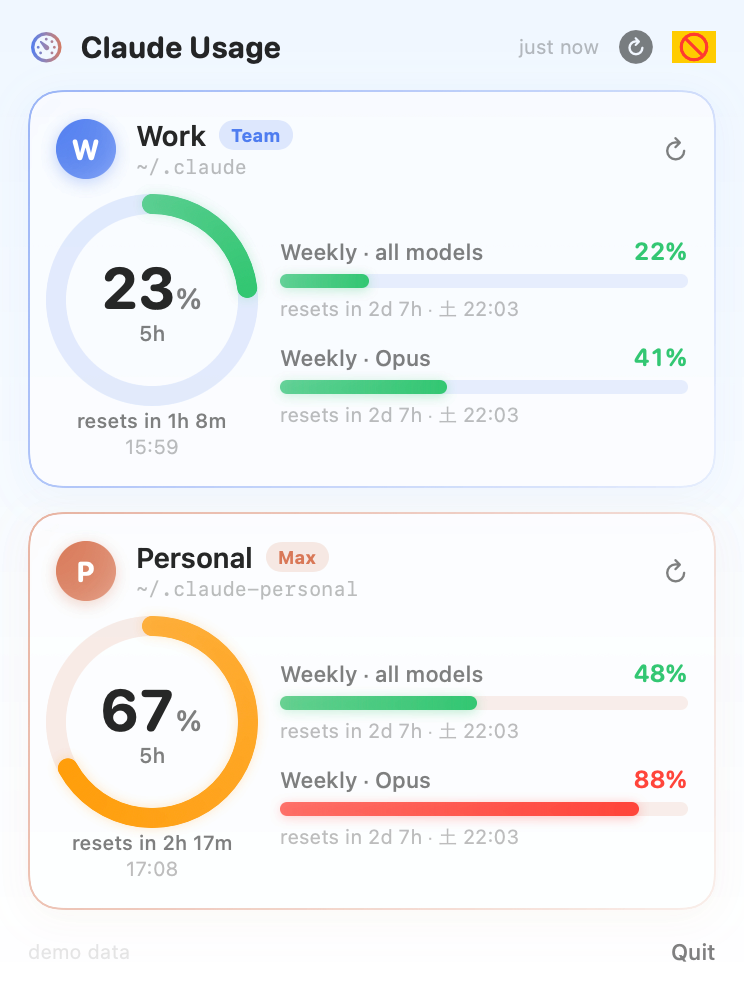

# Claude Usage

Native macOS menu-bar app (SwiftUI, no webview) showing the rate-limit state of
**every Claude Code login on this Mac** — by default the work profile
(`~/.claude`) and the personal one (`~/.claude-personal`).

- Menu bar: one mini ring per profile (arc = 5-hour session usage, tinted by the
  profile colour, red when ≥ 80 %) plus the percentage.
- Popover: a card per profile with an animated 5-hour gauge, weekly bars
  (all models / Opus / Sonnet …), reset countdowns, plan badge, limit status.
- ⚙︎ menu: toggle profiles, menu-bar style, refresh interval, token auto-refresh,
  launch at login.



## How it gets the data

Credentials are read from the same Keychain items Claude Code writes:

| config dir           | Keychain service                          |
|----------------------|-------------------------------------------|
| `~/.claude`          | `Claude Code-credentials`                 |
| anything else        | `Claude Code-credentials-<sha256(dir)[:8]>` |

With that OAuth token the app calls `GET https://api.anthropic.com/api/oauth/usage`
(zero inference cost). If a token only has the inference scope (old
`setup-token` logins, `<configDir>/token`), it falls back to the legacy probe:
one `max_tokens=1` Haiku call and the `anthropic-ratelimit-unified-*` headers.

### Token refresh (writes to Keychain)

Access tokens expire after a few hours and Claude Code only refreshes them while
the CLI is running. So when a token is expired the app refreshes it itself with
the stored `refreshToken` (same client id and endpoint as the CLI) and writes the
result back to the Keychain item in the same JSON format. Reads and writes go
through `/usr/bin/security`, the same binary Claude Code uses, so no extra
Keychain ACL prompt appears. Turn this off with ⚙︎ → *Auto-refresh expired
tokens*; the app then shows "Token expired" until you run `claude` with that
profile.

## Build & install

```sh
scripts/bundle.sh     # swift build -c release → build/Claude Usage.app
scripts/install.sh    # copies to ~/Applications, retires the old LaunchAgent, launches
```

Then enable ⚙︎ → *Launch at login*. Needs Xcode 15 / macOS 14+.

Dev loop: `swift build && .build/debug/ClaudeUsage --demo` (fake data, no
network, no Keychain). `--render-preview out.png` writes the popover as a PNG.

## Custom profiles

Create `~/.config/claude-usage/profiles.json`:

```json
[
  {"id": "work",     "name": "Work",     "configDir": "~/.claude",          "accent": "#4F7CF0"},
  {"id": "personal", "name": "Personal", "configDir": "~/.claude-personal", "accent": "#D97757"}
]
```

## Layout

```
Sources/ClaudeUsage/
  App.swift            MenuBarExtra(.window), --demo / --render-preview
  Store.swift          state, timer, settings (UserDefaults), menu-bar image
  Credentials.swift    Keychain via `security`, OAuth refresh, token-file fallback
  UsageClient.swift    /api/oauth/usage + probe-header fallback
  MenuBarLabel.swift   NSImage renderer for the status item
  Views/               PopoverView, ProfileCard, Gauges (ring, bar, shimmer)
legacy/rust, legacy/python   earlier single-profile trackers (kept for reference)
```
